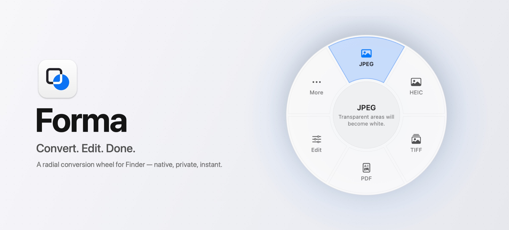
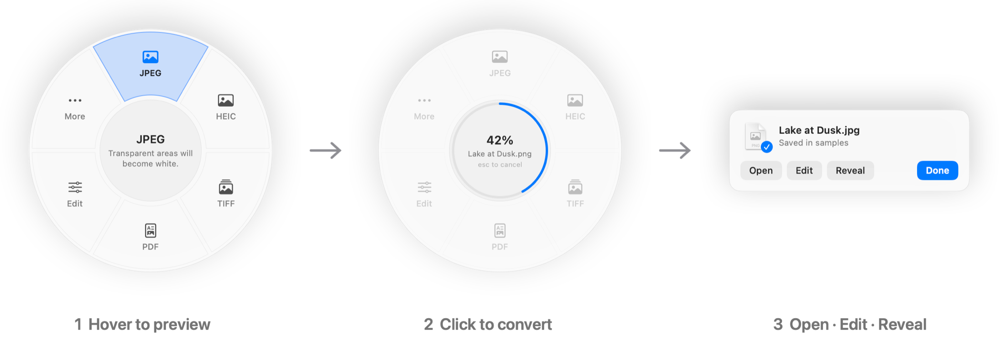
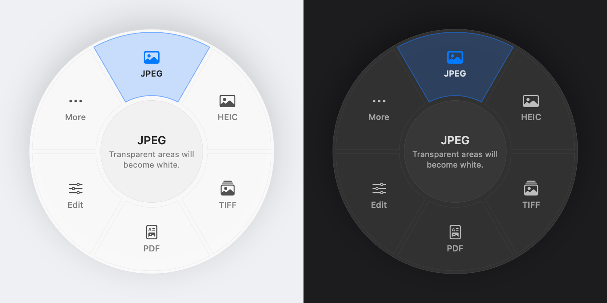
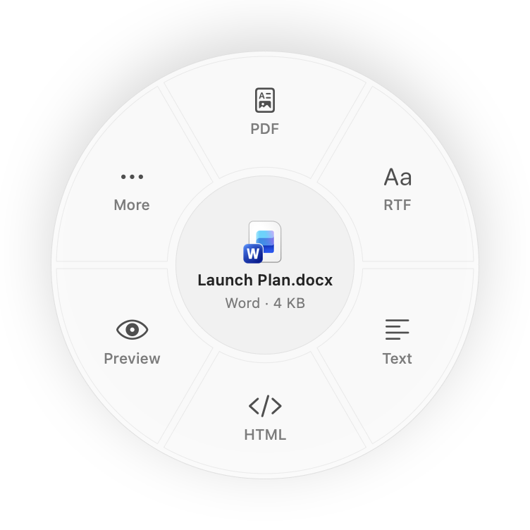
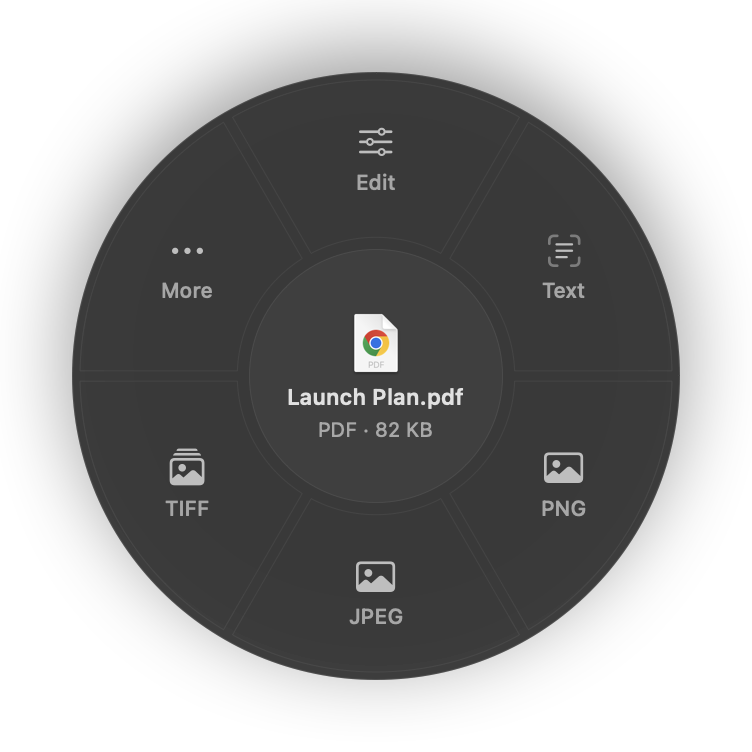
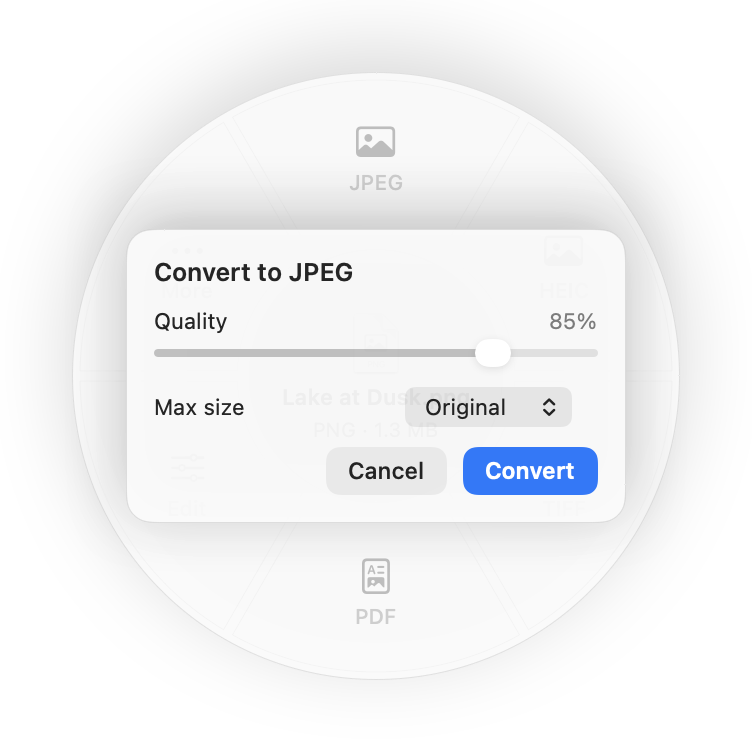
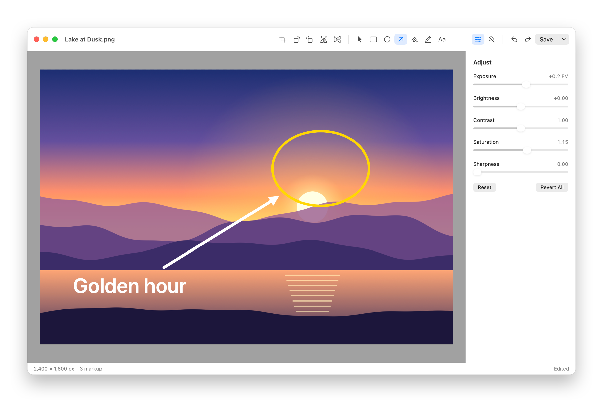
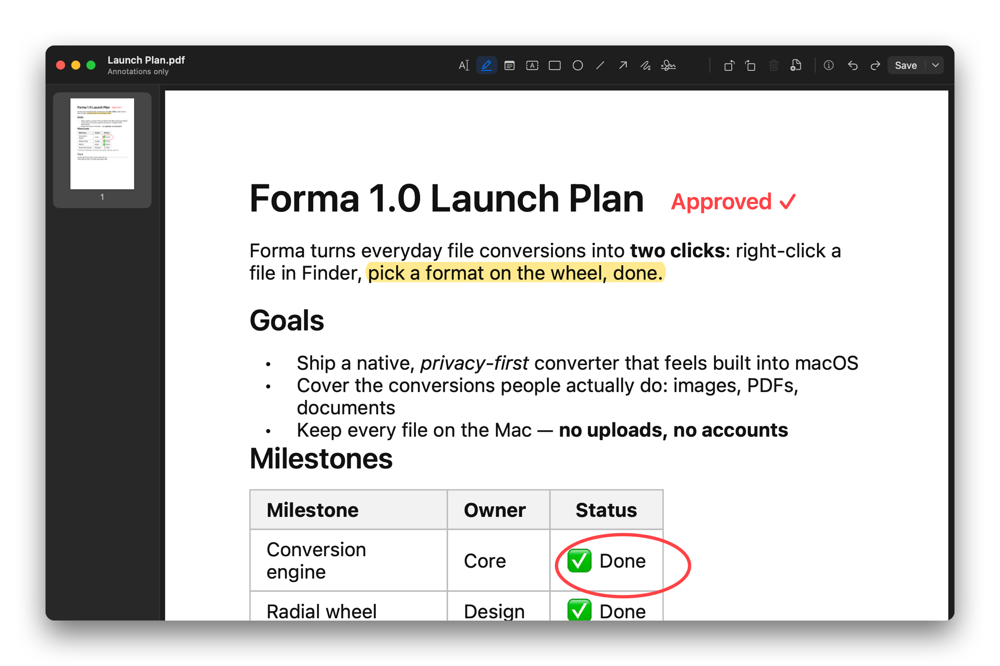
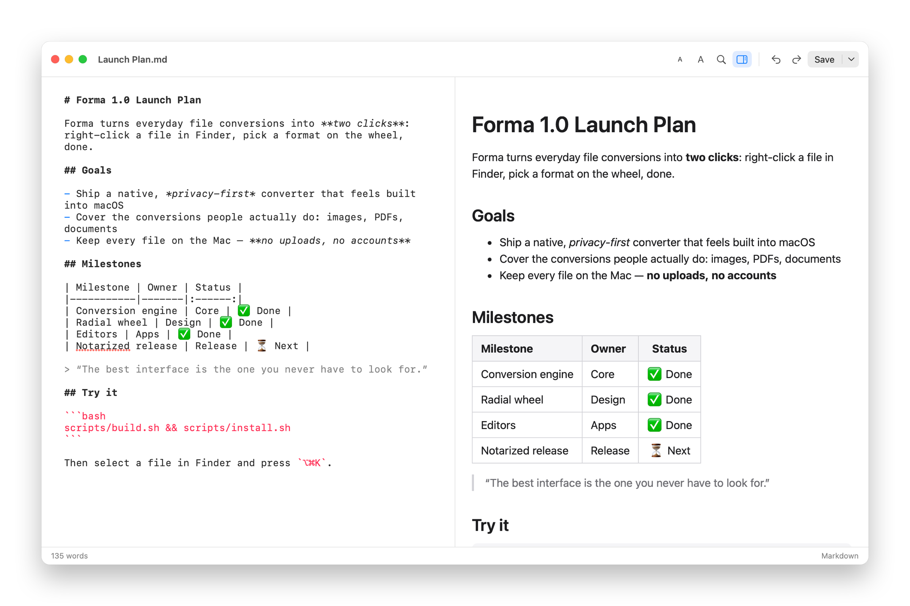

<div align="center">


# Forma

**Convert. Edit. Done.**

A radial conversion wheel for Finder: native, private and instant.

[](#requirements)
[](Package.swift)
[](#built-with)
[](#privacy)
[](#testing)

[Features](#features) · [Install](#install) · [Finder integration](#finder-integration) · [Formats](#supported-formats) · [Editors](#editors) · [Docs](#documentation)

<br>



</div>

<br>

Converting a file on a Mac usually means opening Preview, digging through export menus, installing a single-purpose utility or uploading to a website. **Forma reduces it to two clicks.** Invoke it on a file in Finder, pick a format on the wheel, and the converted file appears next to the original. Open it, edit it or reveal it without switching apps.

<div align="center">

</div>

## Features

<table>
<tr>
<td width="33%" valign="top">

### Radial wheel
Opens at your pointer and stays on screen on every display. Hover a format to see its trade-off before converting, e.g. *"Transparent areas will become white"*. Supports the mouse, arrow keys, number keys and press-drag-release.

</td>
<td width="33%" valign="top">

### Real conversion engine
Built on ImageIO, PDFKit, TextKit, Vision and AVFoundation. Every output is re-encoded and checked by its file signature. Renaming an extension never counts as conversion.

</td>
<td width="33%" valign="top">

### Built-in editors
Crop, adjust and mark up images. Annotate, sign and reorder PDF pages. Write Markdown with a live preview. All with undo/redo, without leaving Forma.

</td>
</tr>
<tr>
<td valign="top">

### Smart, stable ordering
Defaults depend on the file: screenshots favour JPEG and PDF, PDFs lead with Edit and Text. Formats you use often earn a slot, and once on the wheel a format keeps its position for muscle memory.

</td>
<td valign="top">

### Safe by design
Never overwrites anything: if a name is taken it writes `photo 2.jpg`. Files are written atomically, a cancelled conversion leaves nothing behind, and errors are in plain language.

</td>
<td valign="top">

### Batch ready
Select many files to convert each one, or combine images and PDFs into a single PDF. Progress shows in the wheel's hub, with cancel and a report of anything skipped.

</td>
</tr>
</table>

<div align="center">

<br>
<sub>Follows light and dark mode, Increase Contrast and Reduce Motion. Every segment is a labelled VoiceOver button.</sub>
</div>

## The wheel adapts to each file

<table>
<tr>
<td align="center" width="33%"><br><sub><b>Word document</b>: PDF, RTF, Text, HTML</sub></td>
<td align="center" width="33%"><br><sub><b>PDF</b>: Edit, Extract Text, PNG, JPEG</sub></td>
<td align="center" width="33%"><br><sub><b>Hold ⌥</b> for quality, size and resolution</sub></td>
</tr>
</table>

Only conversions that actually work are offered. The wheel shows 4–8 segments, and **More** opens a second ring for the rest.

## Editors

Choose **Edit** on the wheel or on the confirmation card to open the right editor for the file.



<table>
<tr>
<td width="50%"></td>
<td width="50%"></td>
</tr>
<tr>
<td valign="top"><b>PDF</b>: page thumbnails with drag-to-reorder, rotate, delete and insert pages, highlights, notes, text boxes, shapes, drawing and signatures. Forma edits <i>annotations and pages</i>; it can't rewrite a PDF's original text, and it says so.</td>
<td valign="top"><b>Text &amp; Markdown</b>: syntax highlighting, live preview, find &amp; replace, font size, export to PDF/HTML. RTF, Word, ODT and HTML open as rich text, with a clear notice when saving might lose formatting.</td>
</tr>
</table>

**Images:** crop with aspect presets, rotate, flip and resize. Adjust exposure, brightness, contrast, saturation and sharpness, and add rectangle, oval, arrow, pen, highlight and text markup. Edits are non-destructive until you save, and **Save a Copy** is the default action.

## Install

### Requirements

- macOS 14 Sonoma or later
- A Swift 6 toolchain: Xcode, **or just the Command Line Tools** (`xcode-select --install`)

### Build and install

```bash
git clone https://github.com/LimeOsiris/forma.git
```

```bash
cd forma && scripts/build.sh && scripts/install.sh
```

This builds a signed `Forma.app` (ad-hoc unless you set `SIGN_IDENTITY`), installs it to `~/Applications`, registers its Finder extension and Services entry, and launches it. Forma lives in your menu bar.

> [!NOTE]
> There's no notarized download yet. Pre-built binaries need a Developer ID signature, so for now build from source; it takes about two minutes. See [docs/RELEASE.md](docs/RELEASE.md).

## Finder integration

macOS has no public API for replacing Finder's right-click menu, so Forma offers several supported ways in. All of them open the same wheel:

| Entry point | Setup | Permission |
|---|---|---|
| **Right-click › Convert with Forma…** | Turn on *Forma* in System Settings › General › Login Items & Extensions › Finder | none |
| **⌥⌘K** on Finder's selection (configurable) | none | macOS asks once whether Forma may control Finder |
| **Right-click › Services › Open in Forma** | none | none |
| **Shift + right-click** on a file (opt-in) | Settings › Shortcuts › Enable… | Accessibility |
| Drag onto the app, `open -a Forma`, menu bar › Open Forma… | none | none |

Shift + right-click identifies **exactly** which item you clicked through the Accessibility API. If it can't be certain, Finder's normal menu appears instead. [How it works, and its limits →](docs/FINDER_INTEGRATION.md)

### Keyboard

| Key | Action |
|---|---|
| <kbd>←</kbd> <kbd>→</kbd> / <kbd>Tab</kbd> | Move around the wheel |
| <kbd>Return</kbd> / <kbd>Space</kbd> | Choose |
| <kbd>1</kbd>–<kbd>8</kbd> | Choose a segment directly |
| Hold <kbd>⌥</kbd> while choosing | Show options |
| <kbd>Esc</kbd> | Back, cancel or dismiss |
| <kbd>O</kbd> <kbd>E</kbd> <kbd>R</kbd> on the done card | Open · Edit · Reveal |

## Supported formats

| From | To |
|---|---|
| **Images:** PNG, JPEG, HEIC, AVIF, TIFF, BMP, GIF, WebP¹, SVG | PNG, JPEG, HEIC, AVIF, TIFF, BMP, GIF, PDF |
| **PDF** | PNG / JPEG / HEIC per page, multi-page TIFF, text (with on-device OCR for scans), split into pages |
| **Several images or PDFs** | one combined / merged PDF |
| **Markdown** | HTML (styled, standalone), PDF, Word, RTF, ODT, Text |
| **Word (DOCX/DOC), ODT, RTF, RTFD, HTML, Text** | PDF, Word, ODT, RTF, HTML, Text, Markdown |
| **Audio:** M4A, WAV, AIFF, CAF, MP3, FLAC, AAC, and audio from MOV/MP4 | M4A (AAC), WAV, AIFF, CAF, FLAC; MOV ⇄ MP4 rewrap |

<sub>¹ WebP is read natively; writing it needs <code>cwebp</code>.</sub>

**Optional, detected automatically:** [LibreOffice](https://www.libreoffice.org) for high-fidelity Word → PDF, [FFmpeg](https://ffmpeg.org) for MP3 output and `cwebp` for WebP output (`brew install ffmpeg webp`). Forma runs them locally, from fixed install paths, with argument arrays only.

## Privacy

- **Everything happens on your Mac.** No network requests, uploads, accounts, analytics or ads.
- Forma touches only the files you give it. It doesn't index or scan your disk.
- It asks for Accessibility only if you turn on Shift + right-click; macOS asks for Automation the first time you use the shortcut.
- Conversion history, used for wheel ordering, stays in `~/Library/Application Support/Forma` and can be cleared in Settings.

## Building from source

```bash
swift build                          # debug build of the app and engine
```

```bash
scripts/build.sh                     # release Forma.app + Finder extension, signed
```

```bash
scripts/package.sh                   # zip + DMG (notarizes when given a Developer ID)
```

```bash
scripts/screenshots.sh               # regenerate every image in this README from the real app
```

The app binary also has a command line, handy for scripting:

```bash
Forma.app/Contents/MacOS/Forma --convert notes.md --to pdf --out ~/Desktop
```

### Testing

```bash
swift run FormaTestRunner                                  # 67 unit & round-trip tests
```

```bash
swift build --product Forma && .build/debug/Forma --ui-test /tmp/forma-ui   # 44 in-app UI checks
```

- **Unit and round-trip tests** generate real files and check output signatures, pixels (transparency flattened to white, not black), EXIF orientation, page counts, extracted and OCR'd text, audio duration, no-overwrite naming, cancellation and password-protected PDFs.
- **The UI harness** drives the running app the way Finder does: open the wheel, use the keyboard and mouse, convert, open the editor, edit, undo, save. It covers the image, PDF and Markdown editors and batch combine, in light and dark mode.

`swift test` runs the same suite under Xcode. With only the Command Line Tools, use `FormaTestRunner`.

## Built with

Only Apple frameworks, with no third-party packages: **SwiftUI** and **AppKit** for the UI, **ImageIO**, **Core Graphics** and **Core Image** for images, **PDFKit** for PDFs, **Vision** for OCR, **TextKit** for documents, **AVFoundation** for audio, and **FinderSync** for the Finder extension.

```
Sources/FormaCore   UI-free conversion engine: providers, registry, planning
Sources/Forma       the app: wheel, editors, Finder entry points, settings
Extensions/         sandboxed Finder Sync extension
Tests/              Swift Testing suites with real-file fixtures
```

## Documentation

| | |
|---|---|
| [Architecture](docs/ARCHITECTURE.md) | Engine, wheel, editors and concurrency model |
| [Finder integration](docs/FINDER_INTEGRATION.md) | Every macOS mechanism evaluated, setup and limits |
| [Releasing](docs/RELEASE.md) | Signing, notarization, universal builds |
| [Contributing](CONTRIBUTING.md) | Dev setup and guidelines |
| [Changelog](CHANGELOG.md) | Release history |

## Known limitations

- **Shift + right-click** relies on Finder's accessibility tree, which Apple doesn't document. It's opt-in and falls back to Finder's own menu whenever it isn't sure.
- **Word/ODT without LibreOffice** uses the macOS text engine. Headers, footers, footnotes and complex layouts may not carry over, and the app tells you so.
- **WebP and MP3 output** need the optional tools above.
- **Builds** from the scripts are Apple silicon only; universal builds are covered in [docs/RELEASE.md](docs/RELEASE.md).

<br>

<div align="center">
<sub>Forma is an independent project and is not affiliated with Apple. macOS and Finder are trademarks of Apple Inc.</sub>
</div>
